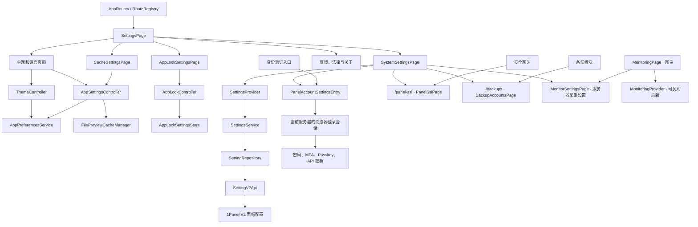

# KenPanel 设置导航与生效范围

## 设置逻辑树

Flutter 界面在手机、平板和桌面共用 `/settings` 的分组。服务器连接为空时，本机设置、诊断和帮助仍可使用。浏览器地址使用 hash，例如 `/#/settings/language`，重新打开时仍会执行浏览器凭据解锁和应用启动检查。

- **外观与语言**
  - 主题 `/settings/theme`。选择跟随系统、浅色或深色。系统提供调色板时可以启用动态色，也可以选择主题色。
  - 界面风格。在首页选择 Material 3 Expressive、Liquid Glass，或本平台支持的原生界面。列表显示保存的风格，窗口切换按平台处理。
  - 语言 `/settings/language`。跟随系统、简体中文或 English，作用于应用界面。
- **安全与存储**
  - 应用锁 `/settings/app-lock`。查看设备认证能力，经验证后启用。设置启动验证、受保护模块、后台重新锁定时间。超时返回时，已打开的受保护内容需要解锁。可以全选模块，也可以清空选择。
  - 文件与存储 `/settings/storage`。配置文件预览缓存、查看内存使用情况、确认清除本机预览。浏览器使用内存缓存。其他平台支持内存、磁盘和混合模式，选择仅磁盘时隐藏内存设置。
    - 图片和 PDF 可以直接在内存中预览。原生音视频播放器需要文件路径，在仅内存模式下使用临时播放文件，退出预览时释放。
  - 文件导出也在「文件与存储」。使用系统文件选择器，或指定默认保存子目录。Web 由浏览器管理下载位置。
- **服务器**
  - 服务器管理 `/server`。添加、编辑、选择连接。
  - 面板设置 `/system-settings`。入口显示当前 1Panel 的名称。
    - 面板。名称、版本、端口与监听地址、开发者模式、IPv6、会话超时，以及应用商店、菜单和仪表盘备注。
    - 网络与终端。终端配置、代理、SSH 和网卡。
    - 安全。「面板账号安全」打开当前服务器的网页登录入口，在已登录的面板中管理密码、MFA、Passkey 和 API 密钥。客户端内可以调整面板密码策略、安全入口、绑定域名和允许的 IP。面板设置和安全网关中的「管理面板证书」共用 `/panel-ssl`，可以查看有效期、导入证书与私钥、保存公开证书。
    - 系统。升级和主机监控。
    - 备份。快照在面板设置中管理。备份账号与备份模块共用 `/backups`。
  - 服务器监控设置可以从面板设置或监控页打开。采集开关、采集间隔（10 至 43200 秒）、保留天数、默认磁盘与网卡、清理主机历史记录作用于打开页面时选定的服务器。
  - 图表设置留在监控页，调整时间范围、数据点数、刷新间隔和 GPU 刷新。离开监控、打开二级页面或切换到后台时暂停自动读取。回到同一连接时保留本次运行的图表选择。
- **帮助与关于**
  - 反馈中心 `/settings/feedback-center`。提交问题、复制反馈模板、预览与导出本机日志、调整日志级别或清理日志。
  - 新手引导。可选择在下次启动时重新显示引导。
  - 法律中心 `/settings/legal-center`。隐私政策、服务条款、开源许可、第三方声明及 SDK 披露。首次打开披露页时读取应用随附的依赖清单，再次进入可直接查看，也可手动刷新。
  - 关于 `/settings/about`。版本、构建信息、项目与发布入口。

## 代码与保存位置

八个本机设置子页、面板安全设置和面板证书页共用 `SettingsScaffold`，由同一组件提供标题、操作区和自适应正文宽度。表单、列表和错误提示按页面需要组合。设置首页独立处理桌面外壳与手机导航。[共享页面组件](../../../../lib/features/settings/widgets/settings_scaffold.dart)

| 设置 | 页面和状态入口 | 保存与生效 |
| --- | --- | --- |
| 导航 | `SettingsPage`、`AppRoutes`、`RouteRegistry` | 命名路由组织本机子页。桌面在应用外壳内打开页面。当前连接决定面板入口是否可用。 |
| 主题与动态色 | `ThemeSettingsPage` → `ThemeController` | `AppPreferencesService` 保存 `app_theme_mode`、`app_use_dynamic_color`、`app_seed_color`，主题随状态刷新。 |
| 语言与界面风格 | `LanguageSettingsPage`、`SettingsPage` → `AppSettingsController` | `app_locale` 控制显示语言，`app_ui_render_mode` 供应用启动时选择界面。 |
| 应用锁 | `AppLockSettingsPage` → `AppLockController` → `AppLockSettingsStore` | 保存启用状态、验证时机、间隔和模块清单。本机认证成功后可以启用。空清单会按用户选择保存。 |
| 缓存 | `CacheSettingsPage` → `AppSettingsController` → `FilePreviewCacheManager` | `cache_strategy` 和 `cache_max_size_mb` 控制后续文件预览。缩小内存上限会立即清理最近未使用的数据。缓存键包含连接标识和文件路径。 |
| 文件导出 | `FileExportSettingsSection` → `AppPreferencesService` | `app_use_file_picker_for_file_operations`、`app_file_save_sub_directory_name` 供 `PlatformFileService` 在导出时读取。 |
| 远程面板 | `SystemSettingsPage` → `SettingsProvider` → `SettingsService` → `SettingRepository` | 通过 1Panel V2 读取和提交。应用日志与文件导出均从本机入口管理。 |
| 面板账号安全 | `PanelAccountSettingsEntry` → 当前服务器网页 | v2.5.1 的密码、MFA、Passkey 与传统 API 密钥配置要求网页登录会话。链接只包含面板地址和安全入口。 |
| 监控 | `MonitoringPage`、`MonitorSettingsPage` | 图表显示由 Dart 状态管理。服务器采集策略通过 1Panel 接口保存。主机监控历史数据需要确认后才能清理。 |
| SDK 披露 | `MainlandSdkDisclosurePage` → `LicenseRegistry` | 进程内复用依赖名称清单，随滚动构建列表项。手动刷新重新读取，失败时可重试。 |

导航入口见 [设置首页](../../../../lib/pages/settings/settings_page.dart) 和 [路由注册](../../../../lib/config/app_route_entries.dart)。本机偏好与面板写入分别见 [AppPreferencesService](../../../../lib/core/services/app_preferences_service.dart) 和 [SettingsService](../../../../lib/features/settings/settings_service.dart)。

## 产品参考

- Grafana 在个人偏好中提供界面主题和语言。KenPanel 把这两个入口放在同一分组，首页展示当前选择。[Grafana 用户偏好](https://grafana.com/docs/grafana/latest/administration/user-management/user-preferences/)
- Grafana 支持面板复用同一次查询的结果。KenPanel 的监控首屏、手动刷新和定时刷新共用一次进行中的读取。[Grafana 共享查询结果](https://grafana.com/docs/grafana/latest/visualizations/panels-visualizations/query-transform-data/share-query/)
- Home Assistant 的用户资料页说明设置作用于当前浏览器或移动应用。KenPanel 的导出、日志、缓存均从本机设置访问，远程面板入口显示服务器名称。[Home Assistant 用户资料](https://www.home-assistant.io/docs/configuration/user-configuration/)
- Netdata 把时间范围与实时播放、暂停放在仪表盘。KenPanel 在监控页调整图表，服务器采集和保留策略共用一个配置页面。[Netdata 时间控制](https://learn.netdata.cloud/docs/dashboards-and-charts/time-controls)
- Flutter 建议限制组件重建范围并按需构建长列表。应用根组件只订阅显示语言和主题，设置首页订阅当前分组需要展示的值。调整文件缓存上限时，两处均无需重建。[Flutter 性能指南](https://docs.flutter.dev/perf/best-practices)
